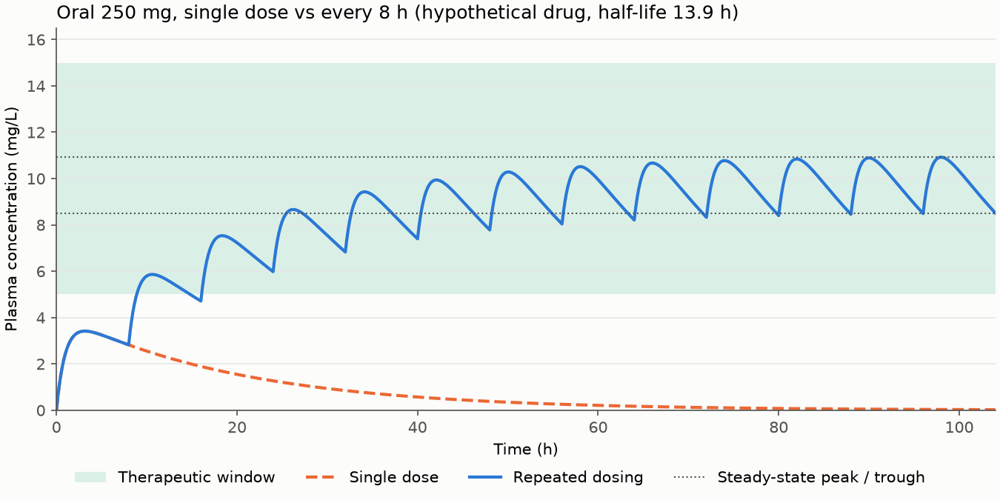

# pk-simulator

Interactive pharmacokinetic simulator: plasma concentration over time for different doses,
routes and dosing intervals.

Think of the body as a bathtub: dosing is the tap, clearance is the drain, and volume of
distribution is the tub size.



A single dose never reaches the therapeutic window. Dosing every 8 h, each dose lands on what's
left of the previous ones, so concentration builds up until the amount eliminated per interval
equals the amount given. That's steady state, about 4 to 5 half-lives in, whatever the dose.

## Models

`src/models.py`, units mg, L, h (concentration in mg/L):

- One-compartment IV bolus: `C(t) = Dose/Vd * exp(-k*t)` with `k = CL/Vd`
- One-compartment oral, first-order absorption `ka` and bioavailability `F` (Bateman function)
- The same one-compartment model solved numerically with `scipy.integrate.solve_ivp`, as a check
- Two-compartment IV (central + peripheral), ODE system solved with `solve_ivp`
- Multiple dosing every `tau` hours, by superposition of single doses (valid for linear PK)

`src/metrics.py`, computed from the simulated curve: Cmax, Tmax, AUC (trapezoidal), terminal
half-life (log-linear fit), steady-state peak and trough, time to steady state (95% of the
steady-state trough).

## Setup

```bash
conda env create -f environment.yml
conda activate pk-simulator
```

or `pip install -r requirements.txt`.

## Run

```bash
streamlit run app.py      # interactive app
pytest                    # checks against analytical results
python make_figure.py     # regenerate the figure above
```

The tests check that:

- the numerical one-compartment solution matches the analytical formula within 1% (IV, oral,
  ka = k and flip-flop)
- AUC = F * Dose / CL
- steady state takes 4 to 5 half-lives for doses of 50, 500 and 5000 mg
- each drug preset reproduces what its sources observed (below)

## Deploy

On Streamlit Community Cloud, point a new app at `app.py`. When a repo has both files, Community
Cloud installs from `environment.yml` (conda) rather than `requirements.txt`.

## Structure

```
src/models.py      PK models
src/metrics.py     Cmax, Tmax, AUC, half-life, time to steady state
src/plotting.py    concentration-time plot used by the app and the figure
src/presets.py     drug presets for the app
tests/test_pk.py   pytest checks
app.py             Streamlit app
make_figure.py     builds figures/single_vs_multiple.png
notebooks/         exploration
```

## Drug presets

The app has a preset menu: a hypothetical drug (also used for the figure above) and 16 real
drugs with published values. Each preset sets the route its values were measured for; you can
switch route afterwards to compare. Per-kg values are scaled to a 70 kg adult and rounded to 0.1 to fit
the slider steps. 1 mcg/mL = 1 mg/L. These are population averages for teaching, not for clinical
use.

### Theophylline, oral

| Parameter | In the app | Published value | Source |
|---|---|---|---|
| CL | 2.7 L/h | 0.65 mL/min/kg, otherwise healthy non-smoking adults 16-60 y (x 70 kg = 2.73 L/h) | [1] Table I |
| Vd | 31.5 L | 0.45 L/kg (range 0.3-0.7), based on ideal body weight | [1] Distribution |
| F | 1.0 | "rapidly and completely absorbed" from oral solution | [1] Absorption |
| ka | 2.0 /h | Not reported. Chosen so the model's Tmax (1.6 h) falls in the reported 1-2 h to peak | derived from [1] Absorption |
| Dose, tau | 200 mg every 8 h | 600 mg/day divided every 6-8 h, the final adult titration step | [1] Table V |
| Window | 10-20 mg/L | therapeutic range 10-20 mcg/mL | [1] |

Check (in `tests/test_pk.py`): the model's half-life is 8.1 h against 8.7 h (range 6.1-12.8) in
[1], and a single 5 mg/kg dose peaks at 9.7 mg/L at 1.6 h against "about 10 mcg/mL (range 5-15)
... 1-2 hr after the dose" in [1].

### Levetiracetam, oral

| Parameter | In the app | Published value | Source |
|---|---|---|---|
| CL | 4.0 L/h | total body clearance 0.96 mL/min/kg (x 70 kg = 4.03 L/h) | [4] 12.3 |
| Vd | 40.4 L | Not reported. Calculated as CL x t1/2 / ln(2) from CL above and the 7 h half-life | derived from [4] 12.3 |
| F | 1.0 | oral bioavailability of the tablets is 100% | [4] 12.3 |
| ka | 3.7 /h | Not reported. Chosen so the model's Tmax (1.0 h) matches peaks "in about an hour" | derived from [4] 12.3 |
| Dose, tau | 1500 mg every 12 h | recommended adult dose, 1500 mg twice daily | [4] 2.2 |
| Window | none | no therapeutic range in the label | - |

The label also states the PK is linear over 500-5000 mg, so superposition is valid. Check (in
`tests/test_pk.py`): the model peaks at 1.0 h, has a 7.0 h half-life (label 7 +/- 1 h) and reaches
steady state at 36 h, inside the label's "after 2 days".

### Levofloxacin, oral

| Parameter | In the app | Published value | Source |
|---|---|---|---|
| CL | 10.4 L/h | CL/F 175 mL/min for 500 mg every 24 h, x F 0.99 | [7] Table 8 |
| Vd | 101.0 L | Vd/F 102 L for 500 mg every 24 h, x F 0.99 | [7] Table 8 |
| F | 0.99 | absolute bioavailability approximately 99% | [7] 12.3 |
| ka | 3.25 /h | Not reported. Chosen so the model's Tmax matches 1.1 h | derived from [7] Table 8 |
| Dose, tau | 500 mg every 24 h | the multiple-dose regimen in Table 8 | [7] Table 8 |
| Window | none | no therapeutic range in the label | - |

Check (in `tests/test_pk.py`): at steady state the model's peak is 4.8 mg/L and trough 0.47 mg/L
against 5.7 +/- 1.4 and 0.5 +/- 0.2 mcg/mL in [7]; half-life 6.7 h (label 6 to 8 h); steady state
at 48 h ("within 48 hours").

### Fluconazole, oral

| Parameter | In the app | Published value | Source |
|---|---|---|---|
| CL | 1.0 L/h | mean body clearance 0.23 mL/min/kg (x 70 kg = 0.97 L/h) | [8] |
| Vd | 43.3 L | Not reported as a number ("approximates that of total body water"). Calculated as CL x t1/2 / ln(2) with t1/2 = 30 h; 0.62 L/kg, consistent with total body water | derived from [8] |
| F | 0.9 | "over 90%"; the app uses the lower bound | [8] |
| ka | 3.35 /h | Not reported. Chosen so the model's Tmax (1.5 h) falls in "between 1 and 2 hours" | derived from [8] |
| Dose, tau | 200 mg every 24 h | 200 mg once daily for 14 days, measured in Table 1 | [8] Table 1 |
| Window | none | no therapeutic range in the label | - |

Check (in `tests/test_pk.py`): on day 14 the model gives Cmax 9.5 mg/L and AUC0-24 180 mg*h/L
against 10.12 mcg/mL and 169.5 mcg*h/mL in [8] Table 1, and reaches steady state in 6 days
("within 5 to 10 days"). The label gives twice the daily dose on day 1 to get there faster; the
app doesn't model loading doses yet.

### Valproate, IV

| Parameter | In the app | Published value | Source |
|---|---|---|---|
| CL | 0.56 L/h | 0.56 L/h per 1.73 m2, total valproate | [6] 12.3 |
| Vd | 11.0 L | 11 L per 1.73 m2, total valproate | [6] 12.3 |
| Dose, tau | 250 mg every 6 h | initial 10-15 mg/kg/day (1000 mg/day = 14 mg/kg/day), divided when above 250 mg/day. The 6 h interval is a choice; the label only says to use the same frequency as the oral product | [6] Dosage and Administration |
| Window | 50-100 mg/L | "usually accepted therapeutic range (50 to 100 mcg/mL)" | [6] |

A 70 kg adult is taken as 1.73 m2. The label notes that total valproate concentration rises less
than proportionally with dose because protein binding saturates, so superposition is only an
approximation here. Check (in `tests/test_pk.py`): the model's half-life is 13.6 h (label 16 +/- 3 h)
and the steady-state peak and trough (86 and 64 mg/L) sit inside the 50-100 mg/L range.

### Gentamicin, IV

| Parameter | In the app | Published value | Source |
|---|---|---|---|
| CL | 5.4 L/h | 1.29 mL/min/kg, patients 20-39 y with normal renal function | [3] |
| Vd | 16.1 L | 0.23 L/kg | [3] |
| Dose, tau | 70 mg every 8 h | 3 mg/kg/day in three equal doses every 8 h | [2] Dosage and Administration |
| Window | 4-12 mg/L | peak expected at 4-6 mcg/mL; avoid prolonged peaks above 12 mcg/mL and troughs above 2 mcg/mL | [2] |

For gentamicin the band shows the peak targets: peaks should reach it and troughs should fall below
2 mg/L, unlike theophylline where the whole curve should stay inside. In practice it is given IM
or as an IV infusion, so the bolus model slightly overstates the peak.

Check (in `tests/test_pk.py`): the model's half-life is 2.1 h against 2.2 h in [3], and at steady
state the peak is 4.7 mg/L and the trough 0.3 mg/L, inside the label's expectations.

### Vancomycin, IV

| Parameter | In the app | Published value | Source |
|---|---|---|---|
| CL | 4.1 L/h | mean plasma clearance about 0.058 L/kg/h | [5] 12.3 |
| Vd | 25.6 L | 0.3 to 0.43 L/kg; the app uses the midpoint, 0.365 L/kg | [5] 12.3 |
| Dose, tau | 1000 mg every 12 h | 2 g/day, as 500 mg every 6 h or 1 g every 12 h | [5] 2.2 |
| Window | none | the label says to measure troughs but gives no target range | - |

Check (in `tests/test_pk.py`): the model's half-life is 4.3 h (label 4 to 6 h) and its
steady-state trough is 6.7 mg/L against "approximately 8 mcg/mL 11 hours after the end of the
infusion" in [5]. The same label reports 63 mcg/mL right after a 1 h infusion, where this model
gives about 39 mg/L. Vancomycin has a fast distribution phase that a one-compartment model can't
show; the two-compartment model in `src/models.py` is the better fit.

### Pregabalin, oral

| Parameter | In the app | Published value | Source |
|---|---|---|---|
| Vd | 31.5 L | apparent Vd/F about 0.5 L/kg, x F 0.9 | [9] 12.3 |
| CL | 3.47 L/h | Not reported as a total. Calculated as Vd x ln(2) / t1/2 with t1/2 6.3 h | derived from [9] 12.3 |
| F | 0.9 | "greater than or equal to 90%"; the app uses the lower bound | [9] 12.3 |
| ka | 3.6 /h | Not reported. Chosen so Tmax is 1.0 h, inside "within 1.5 hours" | derived from [9] 12.3 |
| Dose, tau | 150 mg every 12 h | 150-600 mg/day in 2 or 3 divided doses | [9] 2 |

Check: half-life 6.3 h and steady state at 36 h ("within 24 to 48 hours").

### Lacosamide, oral

| Parameter | In the app | Published value | Source |
|---|---|---|---|
| Vd | 42.0 L | about 0.6 L/kg | [10] 12.3 |
| CL | 2.24 L/h | Not reported. Calculated as Vd x ln(2) / t1/2 with t1/2 13 h | derived from [10] 12.3 |
| F | 1.0 | absolute bioavailability approximately 100% | [10] 12.3 |
| ka | 1.34 /h | Not reported. Chosen so Tmax is 2.5 h, the middle of "1-to-4-hour" | derived from [10] 12.3 |
| Dose, tau | 200 mg every 12 h | monotherapy 150-200 mg twice daily | [10] 2 |

Check: steady state at 60 h ("after 3 days"). PK is dose proportional over 100-800 mg.

### Lamotrigine, oral

| Parameter | In the app | Published value | Source |
|---|---|---|---|
| CL | 2.39 L/h | multiple-dose CL/F 0.58 mL/min/kg, healthy volunteers, x F 0.98 | [11] Table |
| Vd | 75.5 L | Vd/F 0.9-1.3 L/kg; the app uses 1.1, x F 0.98 | [11] 12.3 |
| F | 0.98 | absolute bioavailability 98% | [11] 12.3 |
| ka | 2.63 /h | Not reported. Chosen so Tmax is 1.7 h, the multiple-dose mean | derived from [11] Table |
| Dose, tau | 150 mg every 12 h | usual maintenance 225-375 mg/day | [11] Table 1 |

Check: half-life 21.9 h against the multiple-dose mean of 25.4 h (range 11.6-61.6). These values only
apply without interacting drugs; valproate and enzyme inducers change lamotrigine clearance a lot.

### Topiramate, oral

| Parameter | In the app | Published value | Source |
|---|---|---|---|
| CL | 1.5 L/h | apparent CL/F 20-30 mL/min; the app uses 25 | [12] 12.3 |
| Vd | 45.5 L | Not reported. Calculated as CL/F x t1/2 / ln(2) with t1/2 21 h | derived from [12] 12.3 |
| F | 1.0 | the label gives only relative bioavailability (80% vs solution); CL/F already includes F | [12] 12.3 |
| ka | 2.11 /h | Not reported. Chosen so Tmax is 2 h | derived from [12] 12.3 |
| Dose, tau | 200 mg every 12 h | monotherapy 400 mg/day in two divided doses | [12] 2 |

Check: steady state at 4.0 days ("about 4 days").

### Linezolid, oral

| Parameter | In the app | Published value | Source |
|---|---|---|---|
| CL | 4.8 L/h | 80 mL/min at 600 mg every 12 h | [13] Table 8 |
| Vd | 45.0 L | 40 to 50 L at steady state; the app uses the midpoint | [13] 12.3 |
| F | 1.0 | absolute bioavailability approximately 100% | [13] 12.3 |
| ka | 3.49 /h | Not reported. Chosen so Tmax is 1.03 h, as in Table 8 | derived from [13] Table 8 |
| Dose, tau | 600 mg every 12 h | the regimen in Table 8 | [13] Table 8 |

Check: steady-state peak 16.7, trough 5.3 and AUC 125, against 21.2 (SD 5.78), 6.15 (SD 2.94) and
138 (SD 42.1) in Table 8, all inside one SD.

### Metronidazole, oral

| Parameter | In the app | Published value | Source |
|---|---|---|---|
| CL | 3.36 L/h | Not reported. CL/F = dose / AUC = 750 mg / 223 mcg*h/mL | derived from [14] |
| Vd | 38.8 L | Not reported. CL/F x t1/2 / ln(2) with t1/2 8 h | derived from [14] |
| F | 1.0 | not reported; CL/F and V/F already include it | - |
| ka | 2.07 /h | Not reported. Chosen so Tmax is 1.6 h, as measured | derived from [14] |
| Dose, tau | 500 mg every 6 h | 7.5 mg/kg every 6 h, "approximately 500 mg for a 70 kg adult" | [14] Dosage |

Check: a single 750 mg dose peaks at 16.8 mg/L against 21.4 (SD 2.8) in [14], about 20% low.

### Doxycycline, oral

| Parameter | In the app | Published value | Source |
|---|---|---|---|
| Vd | 61.1 L | Not reported. Set so a 200 mg dose leaves 1.45 mcg/mL at 24 h, as measured | derived from [15] |
| CL | 2.12 L/h | Not reported. Vd x ln(2) / t1/2 with t1/2 20 h (range 18-22) | derived from [15] |
| F | 1.0 | "virtually completely absorbed" | [15] |
| ka | 2.08 /h | Not reported. Chosen so Tmax is 2 h, as measured | derived from [15] |
| Dose, tau | 100 mg every 12 h | 100 mg every 12 h for more severe infections | [15] Dosage |

Check: a single 200 mg dose peaks at 3.05 mg/L against 2.6 mcg/mL in [15], about 17% high.

### Amikacin, IV

| Parameter | In the app | Published value | Source |
|---|---|---|---|
| CL | 6.0 L/h | mean serum clearance about 100 mL/min | [16] |
| Vd | 24.0 L | mean apparent volume of distribution 24 L | [16] |
| Dose, tau | 525 mg every 12 h | 15 mg/kg/day as 7.5 mg/kg every 12 h | [16] Dosage |
| Window | 10-35 mg/L | avoid peaks above 35 and troughs above 10 mcg/mL | [16] |

As with gentamicin, the band isn't a range to stay inside: peaks should stay under 35 and troughs
should drop below 10. Check: 500 mg leaves 1.7 mg/L at 10 h against about 2.1 mcg/mL after IM
dosing in [16]; the model's half-life is 2.8 h against "slightly over 2 hours".

### Daptomycin, IV

| Parameter | In the app | Published value | Source |
|---|---|---|---|
| CL | 0.64 L/h | 9.1 mL/h/kg at 6 mg/kg | [17] Table |
| Vd | 7.07 L | Vss 0.101 L/kg at 6 mg/kg | [17] Table |
| Dose, tau | 420 mg every 24 h | 6 mg/kg once every 24 h | [17] Dosage |

Check: steady-state AUC0-24 656 against 632 (SD 78) and half-life 7.7 h against 7.9 (SD 1.0) in
[17]. The model's peak (67 mg/L) is well under the label's 93.9: like vancomycin, daptomycin has a
distribution phase a one-compartment model can't show.

### Screened but not added

These labels were checked and left out because the one-compartment model can't use them honestly:

- Ciprofloxacin: with CL from the label's AUC and the 4 h half-life, no one-compartment curve
  reaches the measured steady-state peak of 2.97 mcg/mL (the model gives 1.8); it has a marked
  distribution phase.
- Amoxicillin, atenolol, tobramycin: the labels give no clearance or volume of distribution.
- Meropenem, cefazolin: only peak concentrations after infusion and a half-life; the numbers don't
  agree with a single compartment.
- Lithium: no clearance, volume or absorption data, and levels are in mEq/L.
- IV paracetamol: the PK table wasn't readable in the label's structured text.

### References

1. Elixophyllin (theophylline anhydrous) oral solution, prescribing information. Nostrum
   Laboratories, Inc. DailyMed, version of 14 Dec 2018.
   https://dailymed.nlm.nih.gov/dailymed/drugInfo.cfm?setid=b488f996-2f80-438a-8333-b837f9acd4fc
2. Gentamicin sulfate injection, prescribing information. Fresenius Kabi USA, LLC. DailyMed,
   version of 17 Oct 2024.
   https://dailymed.nlm.nih.gov/dailymed/drugInfo.cfm?setid=84f5c763-1cd3-4d85-9afb-934db8666fbf
3. Bauer LA, Blouin RA. Gentamicin pharmacokinetics: effect of aging in patients with normal renal
   function. J Am Geriatr Soc. 1982;30(5):309-311. https://doi.org/10.1111/j.1532-5415.1982.tb05618.x
4. Keppra (levetiracetam) tablets and oral solution, prescribing information. UCB, Inc. DailyMed,
   version of 29 Jan 2026.
   https://dailymed.nlm.nih.gov/dailymed/drugInfo.cfm?setid=3ca9df05-a506-4ec8-a4fe-320f1219ab21
5. Vancomycin hydrochloride for injection, prescribing information. Avenacy, LLC. DailyMed,
   version of 17 Aug 2026.
   https://dailymed.nlm.nih.gov/dailymed/drugInfo.cfm?setid=c757e65b-ca6f-4c00-afe2-025962b43d31
6. Valproate sodium injection, prescribing information. Hikma Pharmaceuticals USA Inc. DailyMed,
   version of 7 Dec 2023.
   https://dailymed.nlm.nih.gov/dailymed/drugInfo.cfm?setid=bcf57b31-4811-4104-82b3-46fb91a53ee0
7. Levofloxacin tablets, prescribing information. Camber Pharmaceuticals, Inc. DailyMed, version of
   15 Aug 2024.
   https://dailymed.nlm.nih.gov/dailymed/drugInfo.cfm?setid=b43e9b51-568c-4d84-bbd1-d237120056c4
8. Diflucan (fluconazole) tablets and oral suspension, prescribing information. Roerig (Pfizer).
   DailyMed, version of 9 Apr 2026.
   https://dailymed.nlm.nih.gov/dailymed/drugInfo.cfm?setid=f694c617-3383-416c-91b6-b94fda371204
9. Pregabalin capsules, prescribing information. RemedyRepack Inc. DailyMed, version of 21 Oct 2026.
   https://dailymed.nlm.nih.gov/dailymed/drugInfo.cfm?setid=c539652e-14b2-4110-950b-ef664d1c3c1c
10. Vimpat (lacosamide), prescribing information. UCB, Inc. DailyMed, version of 13 May 2026.
    https://dailymed.nlm.nih.gov/dailymed/drugInfo.cfm?setid=9e79b42c-38a3-4b2c-a196-a5a1948250e2
11. Lamictal (lamotrigine), prescribing information. GlaxoSmithKline LLC. DailyMed, version of
    20 Aug 2026.
    https://dailymed.nlm.nih.gov/dailymed/drugInfo.cfm?setid=d7e3572d-56fe-4727-2bb4-013ccca22678
12. Topamax (topiramate), prescribing information. Janssen Pharmaceuticals, Inc. DailyMed, version of
    6 Oct 2026.
    https://dailymed.nlm.nih.gov/dailymed/drugInfo.cfm?setid=21628112-0c47-11df-95b3-498d55d89593
13. Zyvox (linezolid), prescribing information. Pharmacia & Upjohn Company LLC. DailyMed, version of
    13 Jul 2026.
    https://dailymed.nlm.nih.gov/dailymed/drugInfo.cfm?setid=3e5e9975-6f36-42e4-ab46-0e75dda83592
14. Flagyl (metronidazole) capsules, prescribing information. Pfizer. DailyMed, version of 25 May 2026.
    https://dailymed.nlm.nih.gov/dailymed/drugInfo.cfm?setid=a2883ca1-5a9a-4259-9d80-46ab67274384
15. Doxycycline hyclate tablets and capsules, prescribing information. Chartwell RX LLC. DailyMed,
    version of 19 Oct 2026.
    https://dailymed.nlm.nih.gov/dailymed/drugInfo.cfm?setid=3e7cf78f-3b48-4614-9fa4-c6d1e0c05a35
16. Amikacin sulfate injection, prescribing information. Sagent Pharmaceuticals. DailyMed, version of
    3 Aug 2026.
    https://dailymed.nlm.nih.gov/dailymed/drugInfo.cfm?setid=f260ff2a-76a0-4672-9516-91c344b67890
17. Cubicin RF (daptomycin), prescribing information. Merck Sharp & Dohme LLC. DailyMed, version of
    20 Jun 2025.
    https://dailymed.nlm.nih.gov/dailymed/drugInfo.cfm?setid=0b1a8885-2198-4a0e-8105-0c76c1cba6c2

## What I found

_To be written._
